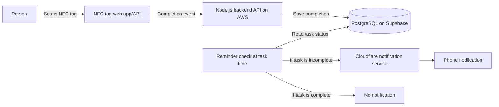
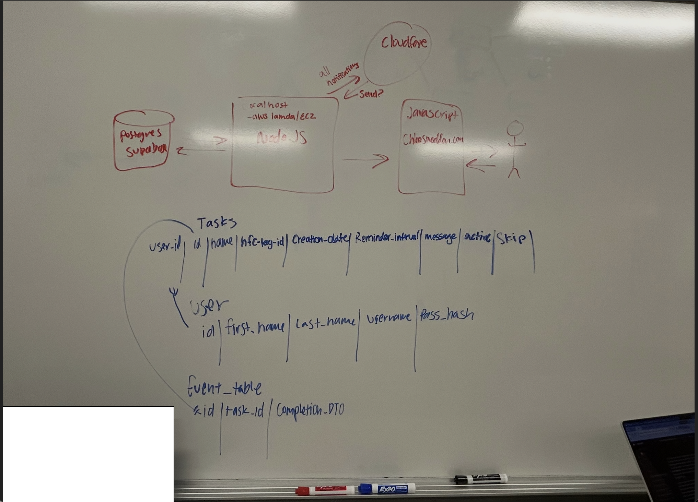

# Project Design: Conditional Task Reminders

## Project purpose

This project is a task manager that sends a phone notification only when a task has not been marked as done by its reminder time. Tasks can be marked done by scanning an NFC tag. The tag itself is configured through a web app API, so this project focuses on receiving and recording the scan event rather than implementing NFC tag programming.

The goal is to make reminders more useful by reducing notifications that repeat information the user already knows. If a task is completed before its reminder time, the user should not receive that reminder. If it is still incomplete at that time, the system should send a notification.

## Goals

- Build a usable task manager by the end of class on December 10, 2026.
- Record tasks, their reminder times, and whether they have been completed.
- Provide an API endpoint that accepts a task completion event from the NFC tag.
- Check task completion when a reminder becomes due and send a phone notification only for an incomplete task.
- Use Node.js for the project, PostgreSQL hosted on Supabase for the database, AWS to host the backend, and Cloudflare for phone notifications.
- Keep the interaction low overhead: completing a task should be as simple as scanning its tag.

## How it should work

The diagram shows the intended flow. The specific Cloudflare notification service and the mechanism that triggers reminder checks still need to be selected during implementation.

## System design diagram & ERD

## Initial work schedule

The schedule below covers November 20 through the December 10 class end date. It includes nine 3-hour work sessions and one final 1-hour review, for **30 planned hours**. The sessions are spaced across the remaining time.

| Date | Planned time | Goal for the session |
| --- | ---: | --- |
| Nov 21 | 3 hours | Turn the project idea into a small feature checklist; choose the minimum task fields and define what makes the project usable for a demo. |
| Nov 23 | 3 hours | Set up the Node.js backend structure and local development workflow. |
| Nov 25 | 3 hours | Connect the backend to Supabase PostgreSQL and create the initial task data model. |
| Nov 28 | 3 hours | Implement API operations to create, view, update, and complete tasks. |
| Nov 30 | 3 hours | Implement the completion-event endpoint for the NFC tag web app; confirm a scan can mark the correct task complete. |
| Dec 2 | 3 hours | Implement due-time checks so completed tasks are skipped and incomplete tasks are selected for notification. |
| Dec 4 | 3 hours | Select and connect the Cloudflare phone notification approach; verify that only an incomplete task triggers a notification. |
| Dec 7 | 3 hours | Deploy the backend to AWS and connect it to the hosted database and notification flow. |
| Dec 9 | 3 hours | Exercise the full task-to-scan-to-reminder flow, fix the main issues, and prepare a usable demonstration. |
| Dec 10 | 1 hour | Final review: confirm the demo works, capture any known limitations, and prepare a short project summary. |
| **Total** | **28 hours** | |

## Completion criteria

The project is ready to demonstrate when a task can be created with a reminder time, a completion event from the NFC tag web app can mark it done, and the reminder flow sends a phone notification only when the task remains incomplete at that time. The deployed backend should be able to read and write task data in Supabase.

## Open implementation choice

The specific Cloudflare product or integration for delivering phone notifications is not defined yet. Choose it during the December 4 session based on the notification method supported by the project.
